# Le schéma de la base

> **Généré** depuis `apps/api/prisma/schema.prisma` et les droits de la migration par `node tools/schema-diagram.mjs` — ne pas modifier à la main. Toute tranche qui touche la base le régénère ; `npm test` échoue s'il est en retard (règle du fondateur du 2026-11-13).

Chaque table porte `tenant_id` — l'élevage —, et chaque lien passe par lui : une ligne ne référence que des lignes de son élevage, et la sécurité par ligne (RLS) cache tout le reste. Ce lien à l'élevage n'est pas dessiné, pour la lisibilité. **PK** : clé primaire ; **FK** : clé étrangère ; une colonne « facultatif » peut rester vide. Un *instant* est une date et une heure en temps universel.

```mermaid
erDiagram
  tenants {
    uuid id PK
    text name
    text currency
    instant created_at
  }
  users {
    uuid id PK
    uuid tenant_id FK
    text phone
    text name
    UserRole role
    AccountAvatar avatar "facultatif"
    AudioLanguage audio_language "facultatif"
    text pin_hash
    instant provisional_pin_expires_at "facultatif"
    instant blocked_at "facultatif"
    instant sessions_valid_from "facultatif"
    instant created_at
  }
  sites {
    uuid id PK
    uuid tenant_id FK
    text name
    text time_zone
    bool strict_mode
    AudioLanguage audio_language "facultatif"
    instant created_at
  }
  site_assignments {
    uuid tenant_id FK
    uuid site_id PK
    uuid user_id PK
    bool is_primary
    instant created_at
  }
  campaigns {
    uuid id PK
    uuid tenant_id FK
    uuid site_id FK
    date placement_day
    text strain
    int planned_headcount
    int planned_duration
    instant closed_at "facultatif"
    uuid leftovers_to FK "facultatif"
    text closing_comment "facultatif"
    text feed_gap_comment "facultatif"
    instant created_at
  }
  journal_events {
    uuid tenant_id PK
    uuid id PK
    uuid site_id FK
    uuid campaign_id FK
    uuid author_id FK
    date business_date
    instant recorded_at
    instant received_at
    uuid device_id
    JournalEventType type "facultatif"
    json fact "facultatif"
    uuid corrects FK "facultatif"
    uuid retracts FK "facultatif"
  }
  correction_reviews {
    uuid tenant_id PK
    uuid correction_id PK
    uuid reviewed_by FK
    instant reviewed_at
  }
  refused_events {
    uuid tenant_id PK
    uuid event_id PK
    uuid site_id FK
    uuid campaign_id FK
    uuid author_id FK
    uuid device_id
    date business_date
    instant recorded_at
    instant received_at
    json event
    json refusal
  }
  audit_events {
    uuid tenant_id PK
    uuid id PK
    instant occurred_at
    AuditAction action
    uuid actor_id "facultatif"
    uuid subject_id
    uuid site_id FK "facultatif"
    uuid device_id "facultatif"
    text reason "facultatif"
  }
  counterparties {
    uuid tenant_id FK
    uuid id PK
    CounterpartyKind kind
    text name
    bool advances_expenses
    text face
    instant archived_at "facultatif"
    instant created_at
  }
  cost_types {
    uuid tenant_id FK
    uuid id PK
    CostCategory category
    text name
    CostBehaviour behaviour
    int bag_weight "facultatif"
    FeedStage feed_stage "facultatif"
    instant archived_at "facultatif"
    instant created_at
  }
  catalog_prices {
    uuid tenant_id FK
    uuid id PK
    uuid cost_type_id FK
    uuid supplier_id FK "facultatif"
    int unit_price
    instant set_at
    uuid set_by
  }
  budget_lines {
    uuid tenant_id PK
    uuid id PK
    CostCategory category PK
    uuid campaign_id FK
    int amount "facultatif"
    instant recorded_at
    uuid recorded_by
  }
  morning_reminders {
    uuid tenant_id PK
    uuid site_id PK
    date day PK
    instant sent_at
  }
  reception_alerts {
    uuid tenant_id PK
    uuid reception_id PK
    date day PK
    instant sent_at
  }
  push_subscriptions {
    uuid tenant_id PK
    uuid device_id PK
    uuid user_id FK
    text endpoint
    text p256dh
    text auth
    instant created_at
  }
  sign_in_attempts {
    uuid tenant_id PK
    uuid user_id PK
    uuid device_id PK
    int failures
    instant last_failure_at "facultatif"
    instant known_since "facultatif"
  }
  campaign_leftovers {
    uuid tenant_id PK
    uuid campaign_id PK
    uuid cost_type_id PK
    int whole
    bool opened
    int opened_weight "facultatif"
  }
  purchase_orders {
    uuid tenant_id FK
    uuid id PK
    uuid supplier_id FK
    uuid campaign_id FK
    date order_day
    text reference "facultatif"
    text currency
    instant announced_at "facultatif"
    instant closed_at "facultatif"
    instant created_at
  }
  payments {
    uuid tenant_id FK
    uuid id PK
    uuid order_id FK
    date paid_on
    int amount
    PaymentMethod method
    uuid paid_by_id FK "facultatif"
    uuid recorded_by
    instant created_at
  }
  order_lines {
    uuid tenant_id FK
    uuid id PK
    uuid order_id FK
    int position
    uuid cost_type_id FK
    int quantity
    int unit_price
    int bag_weight "facultatif"
  }
  planned_receptions {
    uuid tenant_id FK
    uuid id PK
    uuid reception_id
    uuid order_id FK
    date planned_on "facultatif"
    json lines "facultatif"
    bool withdrawn
    instant written_at
    uuid written_by
  }
  sale_forecasts {
    uuid tenant_id FK
    uuid id PK
    uuid forecast_id
    uuid campaign_id FK
    uuid buyer_id FK "facultatif"
    date week "facultatif"
    int birds "facultatif"
    ForecastPricing pricing "facultatif"
    int price "facultatif"
    int average_weight "facultatif"
    bool withdrawn
    instant written_at
    uuid written_by
  }
  attachments {
    uuid tenant_id FK
    uuid id PK
    AttachmentSubject subject_kind
    uuid subject_id
    text media_sha256 FK
    instant attached_at
    uuid attached_by
  }
  media {
    uuid tenant_id PK
    text sha256 PK
    int byte_size
    text content_type
    RetentionClass retention_class
    uuid uploaded_by
    uuid device_id
    instant uploaded_at
  }
  costs {
    uuid tenant_id FK
    uuid id PK
    uuid corrects FK "facultatif"
    uuid campaign_id FK
    uuid cost_type_id FK
    date spent_on
    int amount
    text note "facultatif"
    CostPaymentKind payment_kind
    uuid counterparty_id FK "facultatif"
    text receipt "facultatif"
    instant recorded_at
    uuid recorded_by
  }
  settlements {
    uuid tenant_id FK
    uuid id PK
    uuid counterparty_id FK
    date paid_on
    int amount
    PaymentMethod method
    SettlementDirection direction
    uuid recorded_by
    instant created_at
  }
  sales {
    uuid tenant_id FK
    uuid id PK
    uuid campaign_id FK
    uuid buyer_id FK
    date sold_on
    int birds
    SalePricingKind pricing_kind
    int unit_price
    int grams "facultatif"
    int amount
    uuid recorded_by
    instant created_at
  }
  sale_receipts {
    uuid tenant_id FK
    uuid id PK
    uuid sale_id FK
    date paid_on
    int amount
    PaymentMethod method
    uuid recorded_by
    instant created_at
  }
  weighing_requests {
    uuid tenant_id FK
    uuid id PK
    uuid campaign_id FK
    date requested_for
    uuid requested_by
    instant created_at
  }
  site_assignments }o--|| sites : "site_id"
  site_assignments }o--|| users : "user_id"
  campaigns }o--|| sites : "site_id"
  campaigns }o--o| campaigns : "leftovers_to"
  journal_events }o--|| sites : "site_id"
  journal_events }o--|| campaigns : "campaign_id"
  journal_events }o--|| users : "author_id"
  journal_events }o--o| journal_events : "corrects"
  journal_events }o--o| journal_events : "retracts"
  correction_reviews }o--|| journal_events : "correction_id"
  correction_reviews }o--|| users : "reviewed_by"
  refused_events }o--|| sites : "site_id"
  refused_events }o--|| campaigns : "campaign_id"
  refused_events }o--|| users : "author_id"
  audit_events }o--o| sites : "site_id"
  catalog_prices }o--|| cost_types : "cost_type_id"
  catalog_prices }o--o| counterparties : "supplier_id"
  budget_lines }o--|| campaigns : "campaign_id"
  morning_reminders }o--|| sites : "site_id"
  push_subscriptions }o--|| users : "user_id"
  sign_in_attempts }o--|| users : "user_id"
  campaign_leftovers }o--|| campaigns : "campaign_id"
  campaign_leftovers }o--|| cost_types : "cost_type_id"
  purchase_orders }o--|| counterparties : "supplier_id"
  purchase_orders }o--|| campaigns : "campaign_id"
  payments }o--|| purchase_orders : "order_id"
  payments }o--o| counterparties : "paid_by_id"
  order_lines }o--|| purchase_orders : "order_id"
  order_lines }o--|| cost_types : "cost_type_id"
  planned_receptions }o--|| purchase_orders : "order_id"
  sale_forecasts }o--|| campaigns : "campaign_id"
  sale_forecasts }o--o| counterparties : "buyer_id"
  attachments }o--|| media : "media_sha256"
  costs }o--|| campaigns : "campaign_id"
  costs }o--|| cost_types : "cost_type_id"
  costs }o--o| counterparties : "counterparty_id"
  costs }o--o| costs : "corrects"
  settlements }o--|| counterparties : "counterparty_id"
  sales }o--|| campaigns : "campaign_id"
  sales }o--|| counterparties : "buyer_id"
  sale_receipts }o--|| sales : "sale_id"
  weighing_requests }o--|| campaigns : "campaign_id"
```

## Ce que garde chaque table

« Écriture » dit ce que l'application a le droit d'y faire, d'après la migration : **ajout seul** — jamais modifiée ni effacée (le journal, l'argent, la trace) ; une erreur se corrige par une nouvelle ligne.

| Table | Ce qu'elle garde | Écriture |
|---|---|---|
| `tenants` | L'élevage : son nom et sa devise. Tout le reste lui appartient. | lecture seule |
| `users` | Un compte (gérant ou gardien) : son numéro, l'empreinte de son PIN, son avatar, sa langue, son blocage. | se modifie |
| `sites` | Un poulailler : son nom, son fuseau horaire, sa voix par défaut, son mode strict. | se modifie |
| `site_assignments` | Qui tient le cahier de quel poulailler, et qui en est le titulaire. | se modifie et s’efface |
| `campaigns` | Une bande : sa mise en place, sa souche, son effectif et sa durée prévus ; à la clôture, la bande qui reçoit ses restes, le commentaire du bilan et l'explication d'un écart de sacs d'aliment. | se modifie |
| `journal_events` | Le journal : chaque déclaration (morts, sacs ouverts, réceptions, pesées…), correction ou annulation, avec ses deux dates et son auteur. | ajout seul |
| `correction_reviews` | Le « Vu » d'un admin sur une correction écrite par un gardien : la carte d'« À traiter » s'en va ; écrit une fois, le journal n'est pas touché. | ajout seul |
| `refused_events` | Les déclarations refusées par le serveur, gardées pour que rien ne se perde en silence. | ajout seul |
| `audit_events` | La trace des actions sensibles : qui, quoi, quand, depuis quel appareil. | ajout seul |
| `counterparties` | Un tiers : fournisseur, client ou collaborateur, avec son visage ; s'il peut avancer des frais pour l'élevage. | se modifie |
| `cost_types` | Un type de coût de l'élevage (Aliment démarrage, Vaccin…), rangé sous une catégorie du socle. | se modifie |
| `catalog_prices` | Un prix habituel fixé par l'admin pour un article, pour un fournisseur ou pour tous ; le prochain prix payé le remplace. | ajout seul |
| `budget_lines` | Le budget d'une bande, poste par poste ; la dernière écriture fait foi. | ajout seul |
| `morning_reminders` | Le rappel du matin parti pour un site et le jour dont il demande les morts (7 h, heure du site) : une ligne par jour et par site, pour qu'il ne parte qu'une fois. | ajout seul |
| `reception_alerts` | L'alerte partie pour une réception prévue (le matin de sa date, ou le jour où elle est écrite si sa date est venue) : une ligne par réception et par jour, pour qu'elle ne parte qu'une fois. | ajout seul |
| `push_subscriptions` | L'abonnement aux notifications d'un appareil, à la personne connectée : l'adresse du service de notification du navigateur et ses clés ; supprimé quand le compte est bloqué ou déconnecté. | se modifie et s’efface |
| `sign_in_attempts` | Les essais de PIN d'un compte sur un appareil, et depuis quand l'appareil est connu. | se modifie |
| `campaign_leftovers` | Les restes laissés à la clôture d'une bande : des entiers et un entamé, par type ; pour un sac d'aliment entamé, les kg qui restent s'ils sont connus. | ajout seul |
| `purchase_orders` | Une commande à un fournisseur, pour une bande : annoncée au gardien, puis éventuellement close. | se modifie |
| `payments` | Un paiement d'une commande : sa date, son montant, son moyen, et qui a payé pour l'élevage. | ajout seul |
| `order_lines` | Une ligne d'une commande : un type, une quantité, un prix unitaire. | ajout et effacement |
| `planned_receptions` | Une réception prévue d'une commande reçue en plusieurs fois : sa date et ses lignes ; reprogrammée, une ligne de plus, l'ancienne date reste. | ajout seul |
| `sale_forecasts` | Une vente prévue d'une bande, acheteur par acheteur, par tête ou au kilo ; une ligne par écriture ou retrait, la dernière fait foi. | ajout seul |
| `attachments` | Une photo jointe à une commande ou à un paiement, au moment ou plus tard ; l'écriture ne change pas. | ajout seul |
| `media` | Une photo ou un vocal, nommé par son empreinte ; le fichier lui-même est sur le volume des médias. | ajout seul |
| `costs` | Une dépense d'une bande ; une correction est une nouvelle ligne qui nomme celle qu'elle corrige. | ajout seul |
| `settlements` | Un règlement avec un tiers, vers lui ou reçu de lui. | ajout seul |
| `sales` | Une vente de poulets : l'acheteur, le jour, le nombre, le prix par tête ou au kilo. | ajout seul |
| `sale_receipts` | Un encaissement d'une vente. | ajout seul |
| `weighing_requests` | Une demande de pesée faite au gardien pour un jour ; sa réponse est au journal. | ajout seul |
